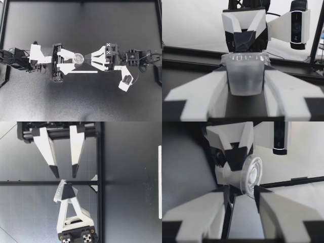
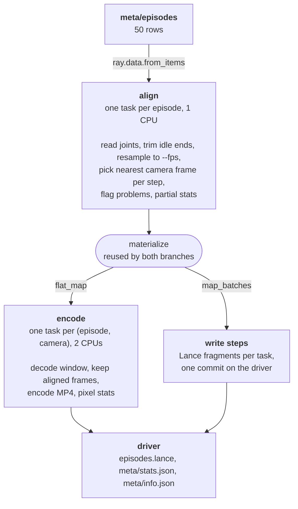

# bench_robotic

A small, runnable example of a robot-learning data pipeline built on [Ray Data](https://docs.ray.io/en/latest/data/data.html).

It takes a recorded robot dataset (joint readings plus camera videos) and turns it into a dataset that a training loop can read quickly at random. Along the way it does the usual offline ingest work: time alignment, resampling, trimming idle time, quality flags, video encoding, normalization statistics, and metadata.



## Contents

- [Quick start](#quick-start)
- [Changing the defaults](#changing-the-defaults)
- [Development](#development)
- [The dataset](#the-dataset)
- [How the pipeline works](#how-the-pipeline-works)
- [What it writes](#what-it-writes)
- [Results](#results)
- [Notes and gotchas](#notes-and-gotchas)
- [Glossary](#glossary)

## Quick start

### What you need

- **Linux x86-64.** The environment is only defined for `linux-64`.
- **[Pixi](https://pixi.sh).** It installs everything else: Python 3.12, Ray, Lance, and FFmpeg with the SVT-AV1, dav1d, and x264 codecs.
- **About 1 GB of free disk.** The download is 486 MB and the default output is about 300 MB.
- **A writable `/data` directory.** By default the dataset goes to `/data/hf` and the output to `/data/robotic`. To use other paths, see [Changing the defaults](#changing-the-defaults).

Public datasets need no Hugging Face account. For gated ones, set the `HF_TOKEN` environment variable.

### Run it

Run these from the repository root, in order:

| # | Command | What it does |
|---|---|---|
| 1 | `pixi install` | Creates the environment in `.pixi/`. |
| 2 | `pixi run test` | Runs the tests on small synthetic data. A quick check that the install works. |
| 3 | `pixi run download` | Downloads the example dataset to `/data/hf/lerobot/aloha_static_cups_open`. |
| 4 | `pixi run ingest` | Runs the pipeline and writes the result to `/data/robotic/aloha_static_cups_open`. Prints a JSON report with timings. |
| 5 | `pixi run sample` | Reads 8 random training samples back from the result and prints how long each read took. |

```bash
pixi install
pixi run test
pixi run download
pixi run ingest
pixi run sample
```

`ingest` starts Ray on your machine and uses every CPU it finds. It took 42 s on a 128-vCPU machine (see [Results](#results)), so expect it to take longer on a laptop.

> [!WARNING]
> Re-running `ingest` deletes the `--dest` directory and writes it again.

## Changing the defaults

Put extra arguments after `--`:

```bash
# Download a dataset to a different place
pixi run download -- --repo lerobot/aloha_static_cups_open --root ~/data/hf

# Read from and write to your own paths, and save the report
pixi run ingest -- --src ~/data/hf/lerobot/aloha_static_cups_open --dest ~/data/robotic/cups --out results/ingest_av1.json

# Encode with H.264 instead of AV1
pixi run ingest -- --codec h264 --dest /data/robotic/aloha_static_cups_open_h264

# Read 16 samples and save a picture of the first one
pixi run sample -- --count 16 --image results/sample.png
```

If you change `--root` for `download`, pass the matching `--src` to `ingest`. If you change `--dest` for `ingest`, pass the same `--dest` to `sample`.

### `download`

| Option | Default | Meaning |
|---|---|---|
| `--repo` | `lerobot/aloha_static_cups_open` | Hugging Face dataset to fetch. |
| `--revision` | `v3.0` | Tag or branch. A tag keeps reruns identical. |
| `--root` | `/data/hf` | The dataset lands in `<root>/<repo>`. |

### `ingest`

| Option | Default | Meaning |
|---|---|---|
| `--src` | `/data/hf/lerobot/aloha_static_cups_open` | Downloaded dataset to read. |
| `--dest` | `/data/robotic/aloha_static_cups_open` | Output directory. Deleted and rewritten on each run. |
| `--fps` | `30` | Output rate in steps per second. |
| `--codec` | `av1` | Video codec: `av1` or `h264`. |
| `--crf` | `30` | Encoder quality. Lower is better quality and bigger files. |
| `--preset` | `8` for AV1, `veryfast` for H.264 | Encoder speed preset. |
| `--gop` | `2` | Frames between keyframes. Small values make random seeks cheap. |
| `--encode-cpus` | `2` | CPUs reserved for each encode task. |
| `--idle-speed` | `0.2` | Joint speed (rad/s) below which the robot counts as still, for trimming. |
| `--out` | none | Also save the JSON report to this file. |

### `sample`

| Option | Default | Meaning |
|---|---|---|
| `--dest` | `/data/robotic/aloha_static_cups_open` | Ingested dataset to read. |
| `--count` | `8` | Number of random steps to read. |
| `--seed` | `0` | Random seed. |
| `--image` | none | Save the first sample's camera views as one image. |

## Development

| Command | What it does |
|---|---|
| `pixi run test` | Runs the tests in `tests/`. |
| `pixi run doctest` | Runs the examples in the docstrings. |
| `pixi run lint` | Checks the code with Ruff. |
| `pixi run ruff format` | Formats the code. |

Public functions have NumPy-style docstrings.

## The dataset

The example uses [`lerobot/aloha_static_cups_open`](https://huggingface.co/datasets/lerobot/aloha_static_cups_open), pinned to the `v3.0` tag.

| | |
|---|---|
| Content | 50 teleoperated demonstrations of a two-armed ALOHA robot picking up a plastic cup and opening its lid |
| Length | 8 s per episode at 50 Hz, 20,000 steps in all |
| Joints | 14-value state and 14-value action per step |
| Cameras | Four 640×480 AV1 videos: overhead, low, and one on each wrist |
| Size | 486 MB |

In LeRobot v3.0, all episodes share one Parquet file, and each camera has one MP4 holding every episode back to back. A `meta/episodes` table gives each episode's row range and its time window inside each video.

The pipeline treats these files as raw recorder output and rebuilds them as a training dataset.

## How the pipeline works



In words: the pipeline first works out, for each episode, which moments in time to keep (**align**). That result then feeds two jobs that run in parallel. One cuts and re-encodes the videos (**encode**), and the other writes the joint data as a table (**write steps**). Last, the main process writes the per-episode table and the metadata files.

| Step | What it does | Code |
|---|---|---|
| Time alignment | Reads each camera's frame timestamps from the MP4 packets without decoding pixels. For each output step, picks the frame with the nearest timestamp and records the worst gap. | `align_episode` in [ingest.py](src/bench_robotic/ingest.py), `nearest` in [steps.py](src/bench_robotic/steps.py) |
| Resampling | Builds an evenly spaced time grid at `--fps` (30 Hz by default, down from 50 Hz) and linearly interpolates state and action onto it. | `time_grid`, `interpolate` in [steps.py](src/bench_robotic/steps.py) |
| Episode trimming | Averages joint speed over 0.2 s and drops still time at both ends, keeping 0.2 s of padding. | `active_range` in [steps.py](src/bench_robotic/steps.py) |
| Quality flags | Marks episodes with problems (listed below). Flags are stored per episode, so training can filter on them. | `align_episode` in [ingest.py](src/bench_robotic/ingest.py) |
| Video encoding | Writes one MP4 per episode and camera at the output rate, so frame *k* belongs to step *k*. A GOP of 2 keeps seeks cheap for random access. | `encode_camera` in [ingest.py](src/bench_robotic/ingest.py), `encode` in [source.py](src/bench_robotic/source.py) |
| Normalization stats | Each task returns count, sum, sum of squares, min, and max. The driver merges them into mean, std, min, and max. Image stats sample every 10th frame. | `partial_stats`, `merge_stats` in [steps.py](src/bench_robotic/steps.py) |
| Metadata | Writes `info.json` with robot type, fps, cameras, codec, tasks, joint names, and the pipeline settings. | `run_ingest` in [ingest.py](src/bench_robotic/ingest.py) |
| Read-back | Does what a training loader does: takes random steps from Lance, normalizes the state, and decodes the matching frame from each camera. | [sample.py](src/bench_robotic/sample.py) |

Quality flags:

| Flag | Raised when |
|---|---|
| `too_short` | The episode is under 1 s after trimming. |
| `joint_jump` | A joint moves more than 0.3 rad between two steps. |
| `camera_gap` | The nearest camera frame is more than half a step away. |
| `non_finite` | The data has NaN or infinite values. |

## What it writes

```text
/data/robotic/aloha_static_cups_open/
├── steps.lance             one row per step: episode_index, step_index, timestamp, state[14], action[14]
├── episodes.lance          one row per episode: trim window, flags, alignment error, video paths
├── videos/<camera>/episode_000000.mp4
└── meta/
    ├── info.json           robot type, fps, cameras, codec, tasks, joint names, settings
    └── stats.json          mean, std, min, max for state, action, and pixels
```

To load a training sample, read a row from `steps.lance`, then decode frame `step_index` from that episode's video for each camera. [sample.py](src/bench_robotic/sample.py) shows this end to end.

## Results

Measured on a 128-vCPU Azure VM (2× Xeon Platinum 8370C), with source and output on a local RAID 0 at `/data`. Ray ran locally with 128 CPUs.

| | AV1 (SVT-AV1 preset 8, CRF 30) | H.264 (x264 veryfast, CRF 30) |
|---|---|---|
| Output steps | 11,899 of 20,000 (30 Hz instead of 50 Hz, 4.3 s trimmed in all) | same |
| Frames encoded (4 cameras) | 47,596 | 47,596 |
| align | 7.2 s | 7.3 s |
| encode | 33.3 s (about 1,430 frames/s; 6.6 s per task) | 16.5 s (1.9 s per task) |
| write steps | 0.2 s | 0.2 s |
| Total | **41.8 s** | **25.2 s** |
| Video size | 301 MB (source: 508 MB at 50 Hz) | 148 MB |
| Quality: PSNR against the source frame | 43.0 dB | 36.7 dB |
| Random read: 16 steps from Lance | 5 ms | 5 ms |
| Random read: decode one frame | 13 ms | 4 ms |

### Correctness checks

- Every output video has exactly as many frames as its episode has steps.
- No episodes were flagged.
- The largest gap between a step and its chosen frame is 6.7 ms. That is expected when sampling 50 Hz frames on a 30 Hz grid.
- Each output frame matches the source frame it was meant to match at 41–44 dB PSNR. A frame five steps away scores 22–39 dB, so alignment picks the right frame.

### What the numbers show

- **Encoding is the whole cost.** It is 80% of the AV1 run. Alignment and the steps table are small. A larger dataset scales by adding CPUs or nodes to the encode stage.
- **The two codecs trade size and quality against read cost.** At the same CRF, x264 runs faster and its files are half the size, but quality is 6 dB lower. AV1 keeps quality higher at a moderate size. AV1 also decodes about 3× slower, and decoding runs on every training read. Compare codecs at matched quality, not matched CRF.
- **Trimming removed little from this dataset.** The ALOHA leader arms are never fully still (the teleop signal has a noise floor of about 0.08 rad/s), and the collectors already cut episodes to 8 s of task motion. The same code trims a raw recording with idle time at the ends; [test_ingest.py](tests/test_ingest.py) checks that on synthetic data.
- **The source is already synchronized** at 50 Hz, so alignment here is resampling. With raw logs, where cameras and joints run on separate clocks, the same nearest-timestamp step does the real matching, and `max_align_error_ms` and the `camera_gap` flag catch dropped frames.

## Notes and gotchas

- **`write_lance` is not used.** Ray 2.60's built-in `Dataset.write_lance` fails with pylance 14, because Ray passes a `storage_options_provider` argument that pylance no longer accepts. The pipeline writes Lance fragments from Ray tasks with `lance.fragment.write_fragments` and commits them once on the driver. That is what `write_lance` does internally.
- **Columns are `state` and `action`,** not LeRobot's `observation.state`. Lance reads a `.` in a top-level column name as a struct path.
- **Workers need the source path.** Ray workers import `bench_robotic` by name, so `run_ingest` passes the source directory to them through `runtime_env`.
- **Re-encoding costs a little quality.** The source is already compressed AV1, so each pass loses some. With raw camera frames, encoding happens once.

## Glossary

| Term | Meaning |
|---|---|
| Episode | One recorded demonstration of the task, from start to finish. |
| Step | One moment in an episode: a joint state, an action, and one frame per camera. |
| State / action | What the robot's joints measured, and what they were commanded to do. |
| Teleoperated | A person drove the robot, here by moving a pair of "leader" arms that the robot copies. |
| [LeRobot](https://github.com/huggingface/lerobot) | Hugging Face's robot-learning library and dataset format. |
| [Lance](https://lancedb.github.io/lance/) | A columnar table format with fast random row access. |
| Driver | The main Ray process that launches tasks and collects their results. |
| CRF | The encoder's quality setting. Lower means better quality and bigger files. |
| GOP | Group of pictures: the distance between keyframes. Decoding a frame starts from the keyframe before it. |
| PSNR | A measure of how close a compressed image is to the original, in dB. Higher is closer. |
